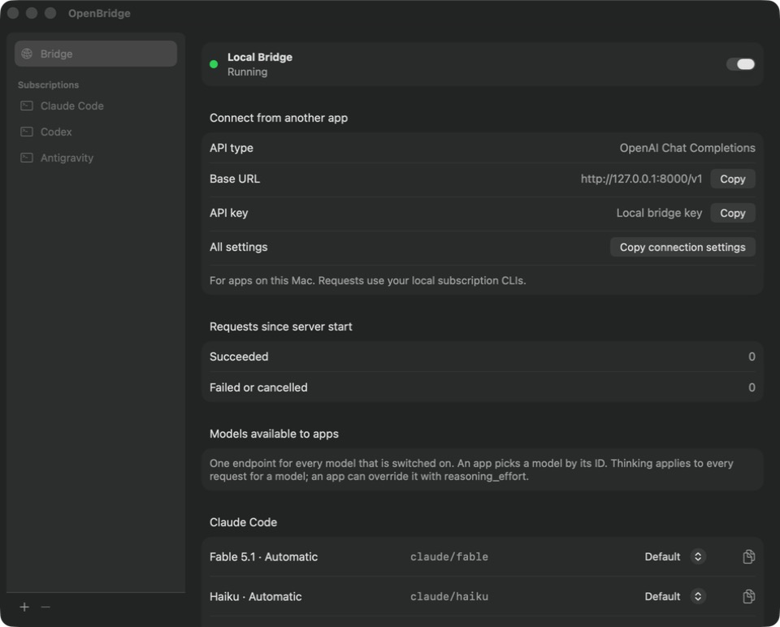
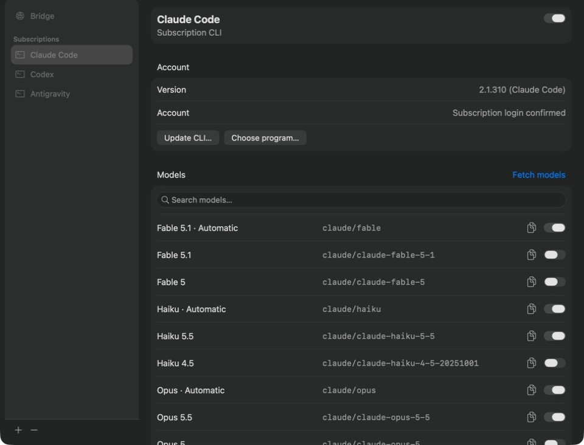
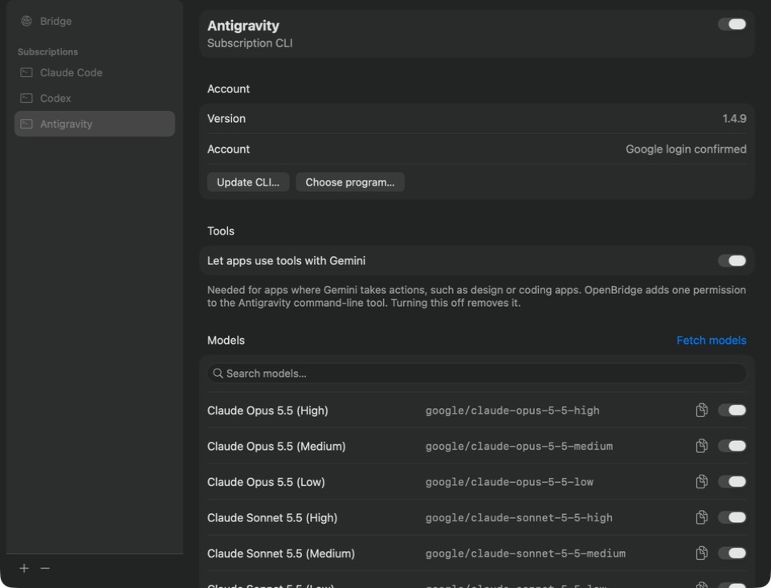

<div align="center">

# OpenBridge

**Use the AI command-line tools on your Mac from your own apps.**

OpenBridge is a small macOS app that turns the AI CLIs you already use —
Claude Code, Codex and Antigravity — into one local, OpenAI-compatible endpoint.

[Download](https://github.com/dartoum/OpenBridge/releases/latest) ·
[Quick start](#quick-start) ·
[Connect an app](#connect-an-app) ·
[Reference](docs/REFERENCE.md)



</div>

## Why OpenBridge

- **One endpoint, several CLIs.** Your apps talk to `http://127.0.0.1:8000/v1` and
  pick a model by ID — Claude, ChatGPT or Gemini.
- **Real tool calls.** Apps that let the model take actions (design tools, coding
  assistants, agents) get proper `tool_calls` back. Your app runs the tools;
  OpenBridge never does.
- **Runs the official CLIs.** No copied tokens or reverse-engineered APIs:
  OpenBridge starts the vendor's own command-line tool with its own sign-in.
- **Stays on your Mac.** It listens on `127.0.0.1` only, refuses browser pages and
  keeps no logs of prompts or answers.
- **You choose the models.** Switch models on or off per CLI; apps only see what
  you turned on.

## Requirements

- macOS 14 or later, on Apple silicon or Intel.
- At least one of these CLIs, installed and signed in:
  **Claude Code** (`claude`), **Codex** (`codex`) or **Antigravity** (`agy`).
  OpenBridge finds them in the usual places by itself.

## Install

1. Download **OpenBridge-x.y.z.dmg** (or the `.zip`) from the
   [latest release](https://github.com/dartoum/OpenBridge/releases/latest).
2. Drag **OpenBridge** to **Applications**.
3. Open it. The first time, macOS says it cannot verify the developer: the app is
   signed but not notarized by Apple. Go to **System Settings › Privacy &
   Security**, scroll down and click **Open Anyway**. You only do this once.

## Quick start

1. **Open OpenBridge.** The bridge starts by itself; the green dot says *Running*.
2. **Pick your models.** Open a CLI in the sidebar and switch on the models your
   apps may use. **Fetch models** loads the list from the CLI.
3. **Copy the settings into your app.** On the Bridge page, **Copy connection
   settings** copies the base URL and the key; each model has its own copy button
   for its ID.



## Connect an app

Any app or SDK that speaks the OpenAI Chat Completions API can connect.

| Setting  | Value |
|----------|-------|
| API type | OpenAI-compatible (Chat Completions) |
| Base URL | `http://127.0.0.1:8000/v1` |
| API key  | **Copy** on the Bridge page (a local key, not a vendor key) |
| Model    | An ID from the Bridge page, such as `claude/sonnet` or `chatgpt/default` |

```sh
curl http://127.0.0.1:8000/v1/chat/completions \
  -H "Authorization: Bearer $OPENBRIDGE_KEY" \
  -H "Content-Type: application/json" \
  -d '{"model": "claude/sonnet", "messages": [{"role": "user", "content": "Hello"}]}'
```

Call it from your app's backend or from a desktop app; web pages in a browser
are refused on purpose.

## What works where

|                         | Claude Code | Codex | Antigravity |
|-------------------------|:-----------:|:-----:|:-----------:|
| Chat and streaming      | ✓ | ✓ | ✓ |
| Tool calls              | ✓ | ✓ | ✓ ¹ |
| JSON output (`response_format`) | ✓ | ✓ | ✓ |
| Thinking level          | ✓ | ✓ | in the model ID |

¹ Turn on **Let apps use tools with Gemini** on the Antigravity page once.
Antigravity only passes full tool calls to OpenBridge with that permission; the
switch adds one rule to the Antigravity command-line tool and removes it again
when you turn it off.



## Good to know

- **One request at a time.** Others wait their turn (up to 30 seconds), then get
  `429` with `Retry-After`. Each request can take up to 120 seconds.
- **CLIs are not APIs.** Sampling options such as `temperature` or `max_tokens`
  cannot be applied; OpenBridge says so in an `X-OpenBridge-Ignored` header.
  Options that would change the result, such as `n`, return `422`.
- **Tool calls arrive whole.** Replies with tool calls are buffered, so streaming
  clients get each call in one piece.
- **Usage is reported, never estimated.** Token counts come from the CLI; when a
  CLI reports none, the response has none.
- **Antigravity keeps its own history.** The Antigravity CLI stores its
  conversations, including those from OpenBridge, in
  `~/.gemini/antigravity-cli/conversations`. Claude Code and Codex runs are not saved.

## Use it responsibly

OpenBridge is a personal tool for your own Mac. Requests run on your own account
through the vendor's official CLI, so that vendor's terms of use and usage limits
apply to everything you send through it. Check those terms for how you plan to use
it, and do not share your endpoint or key with other people.

OpenBridge is an independent project. It is not affiliated with, endorsed by or
sponsored by Anthropic, OpenAI or Google. Claude, ChatGPT, Codex, Gemini and
Antigravity are trademarks of their respective owners.

## Build from source

Needs Xcode command-line tools and Node.js 22 or later.

```sh
npm test                      # server tests
scripts/check-native.sh       # app-side checks
scripts/build-menubar.sh      # builds build/OpenBridge.app for this Mac
open build/OpenBridge.app
scripts/package-release.sh    # universal .dmg and .zip in build/release/
```

The server also runs without the app: `npm start` serves on port 8000 with its
state in the current folder.

## More

- [Reference](docs/REFERENCE.md): every option, model IDs, tool calling, updates
  and where OpenBridge keeps its state.
- [License](LICENSE): MIT.
